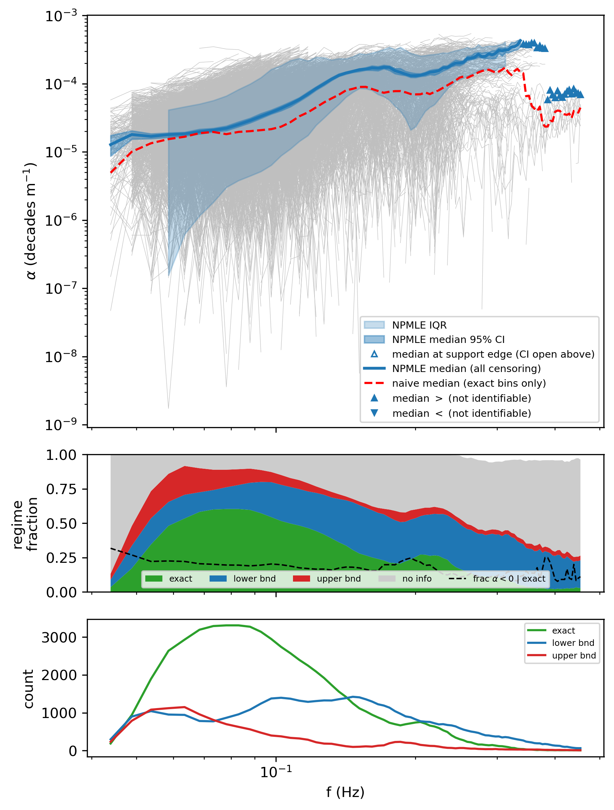
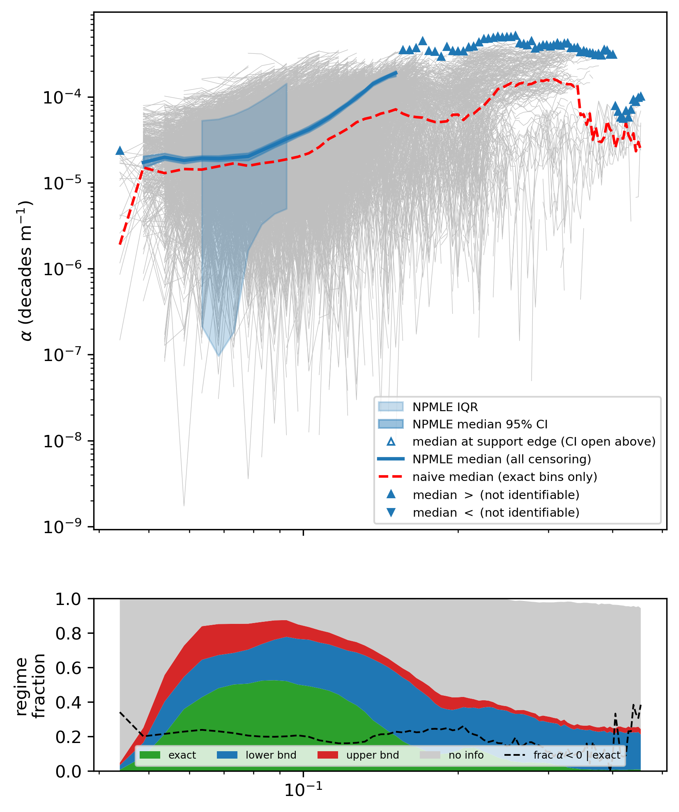

## 1. Introduction

The attenuation coefficient is defined as:

$$\alpha(f) = \frac{\ln [E_i(f)]-\ln[E_j(f)]}{D_{i,j}}$$

OMBs use an accelerometer to measure vertical acceleration. Instrumental noise is
noticeable at frequencies where wave energy is minimal. The recorded acceleration
spectrum is:

$$S_{obs} = S_{true} + e \ge S_{ture}$$

## 2. Key idea

At each (pair, frequency) bin, each of the two buoys is either detected or not.
That gives four combinations, and three of them carry information.

*Figure 1: The four regimes at one frequency (grey dashed vertical line). Solid lines
are what the buoy records, faint dashed lines the true spectrum, dotted horizontal
lines each buoy's own noise floor. Note that the two buoys have different floors —
that is why the third case, in which the upstream buoy is the blind one, occurs at all.*

1. **Both detected.** Both spectra are trustworthy, so Eq. (1) gives $\alpha$
   exactly. Call this an *exact* observation.
2. **Downstream not detected, upstream detected.** The recorded $S_\mathrm{dn}$ is
   too large (Eq. 2), so the computed $\alpha$ is too small — but by how much we do
   not know. What we do know is that the true $\alpha$ is at least the computed
   value: $\alpha_\mathrm{true} \geq \alpha_{obs}$ (a *lower bound*).
3. **Upstream not detected, downstream detected.** Now the recorded
   $S_\mathrm{up}$ is too large, so the computed $\alpha$ is too large:
   $\alpha_\mathrm{true} \leq \alpha_{obs}$ (an *upper bound*).
4. **Neither detected.** Both spectra are overstated by unknown amounts, and the
   errors work in opposite directions on the ratio, so little can be said. These
   bins are discarded.

The current SOP of estimating attenuation coeffcient is to use pointwise median value 
to represent the result for a deploymentj. This actually causes artificial rollover, 
see example below. 

*Figure 2: 5 attenaution profiles vs. freqeuncy. The dashed lines are part that is noise
contaminated and discarded from median calculation, while the real attenuation might look
like these. The red line is the median result, and rollover appears.*

## 3. Fix tool
The estimator that handles exact, left- and right-censored data simultaneously is the non-
parametric maximum-likelihood estimator (NPMLE). 
The algorithm is an EM iteration with a very intuitive reading:
1. Start with mass spread uniformly over the support points.
2. E-step. Take each censored observation (lower bound and upper bound cases) and spread its
weight over all the support points (exact value cases) it is compatible with, in proportion
to how much mass those points currently hold. 
3. M-step. Re-count the total weight at each support point.
4. Repeat until nothing moves. Take median as 50% mass.

For example, suppose one frequency bin of a deployment yields five pair estimates
(in units of $10^{-5}\ \mathrm{m^{-1}}$):

| # | Type | Value |
|---|------|-------|
| 1 | exact | 1.0 |
| 2 | exact | 1.5 |
| 3 | exact | 3.0 |
| 4 | lower bound | $\geq 1.2$ |
| 5 | lower bound | $\geq 2.0$ |

The current SOP keeps only the three exact values, giving a median of 1.5.

The NPMLE keeps all five, giving a median of 3.0.

- **E-step.** Observation 4 is compatible with 1.5 and 3.0, which currently hold
  equal mass, so its weight is split evenly between them. Observation 5 is
  compatible only with 3.0 and places all of its weight there.
- **M-step.** The total weight at each support point is $(1,\ 1.5,\ 2.5)$, which
  normalises to $(0.20,\ 0.30,\ 0.50)$.
- **Repeat.** Each subsequent pass shifts a little more weight onto 3.0; the
  iteration converges to $(0.20,\ 0.27,\ 0.53)$.

The cumulative mass first reaches 50% at 3.0, so the NPMLE median is 3.0 rather
than 1.5. The difference comes entirely from the two censored pairs that the
current SOP discards, and these are not a random subset: a pair is censored
precisely when its downstream spectrum has fallen below the noise floor, which
tends to happen for the more strongly attenuating pairs.

## 4. Real cases
The figures below are from OMB dataset 2022_DOFI_UIO and 2022_AWI_UTOKYO, respectively. It can 
be found that rollover can be significantly corrected after applying the estimator. It directly
affects the estimate of slop of the attenuation profile, and thus affect parameterization performance.

*Figure 3: 2022_DOFI_UIO*

*Figure 4: 2022_AWI_UTOKYO*

