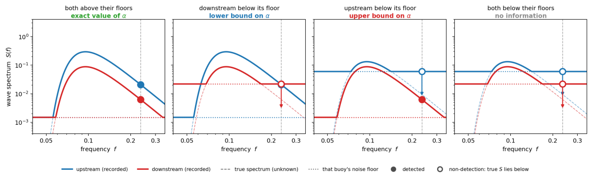
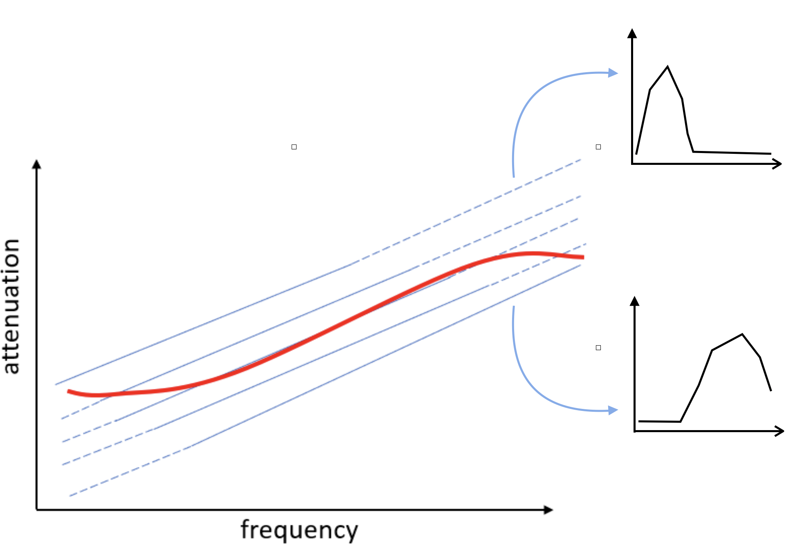

## 1. Introduction

The attenuation coefficient is defined as:

$$\alpha(f) = \frac{\ln [E_i(f)]-\ln[E_j(f)]}{D_{i,j}}$$

OMBs use an accelerometer to measure vertical acceleration. Instrumental noise is
noticeable at frequencies where wave energy is minimal. The recorded acceleration
spectrum is:

$$S_{obs} = S_{true} + e \ge S_{ture}$$

## 2. Key idea

At each (pair, frequency) bin, each of the two buoys is either detected or not.
That gives four combinations, and three of them carry information.

*Figure 1: The acceleration spectrum vs. frequency to demonstrate the four regimes at one frequency (grey dashed vertical line). Solid lines
are what the buoy records, faint dashed lines the true spectrum, dotted horizontal
lines each buoy's own noise floor. Note that the two buoys have different floors —
that is why the third case, in which the upstream buoy is the blind one, occurs at all.*

1. **Exact value**. This occurs when $E_{i,\mathrm{obs}}(f) \ge 10\,e_i(f)$ and $E_{j,\mathrm{obs}}(f) \ge 10\,e_j(f)$. The influence of instrument noise on both buoys is negligible, so $\alpha_\mathrm{true}=\alpha_\mathrm{obs}$ is assumed.
2. **Right-censored**. This occurs when $E_{i,\mathrm{obs}}(f) \ge 10\,e_i(f)$ and $E_{j,\mathrm{obs}}(f) < 10\,e_j(f)$. The observed attenuation is underestimated: $\alpha_\mathrm{true}\ge\alpha_\mathrm{obs}$.
3. **\item Left-censored**. This occurs when $E_{i,\mathrm{obs}}(f) < 10\,e_i(f)$ and $E_{j,\mathrm{obs}}(f) \ge 10\,e_j(f)$. The observed attenuation coefficient is overestimated: $\alpha_\mathrm{true}\le\alpha_\mathrm{obs}$.
4. **No information**. This occurs when $E_{i,\mathrm{obs}}(f) < 10\,e_i(f)$ and $E_{j,\mathrm{obs}}(f) < 10\,e_j(f)$. Both spectra are dominated by noise in the frequency bin, so the bin carries no information and the estimated result is discarded.

The current SOP of estimating attenuation coeffcient is to use pointwise median value 
to represent the result for a deploymentj. This actually causes artificial rollover, 
see example below. 

*Figure 2: 5 attenaution profiles vs. freqeuncy. The dashed lines are part that is noise
contaminated and discarded from median calculation, while the real attenuation might look
like these. The red line is the median result, and rollover appears.*

